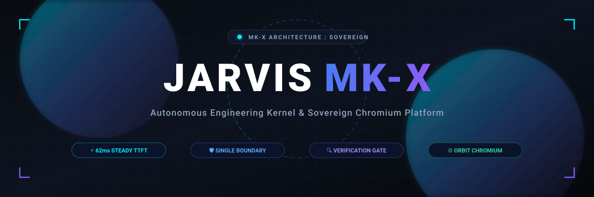
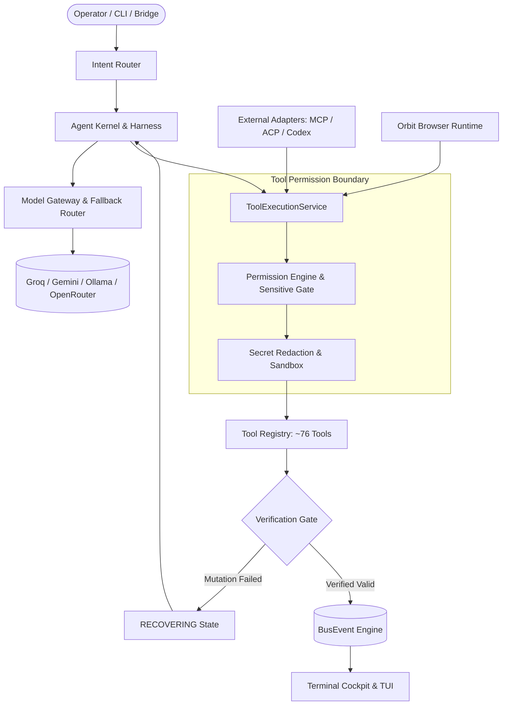
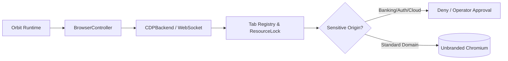

<div align="center">



<br/>

[](https://python.org)
[](https://github.com/Railgunonyx1/JARVIS/actions/workflows/ci.yml)
[](https://github.com/astral-sh/ruff)
[](LICENSE)

<br/>

**The Autonomous Engineering Kernel & Sovereign Chromium Browser Workspace**

[Overview](#overview) · [Quick Start](#quick-start) · [Architecture](#architecture) · [Documentation](#documentation)

</div>

---

## Overview

**JARVIS MK-X** is an autonomous software engineering agent and daily-driver browser workspace. Every tool call—from the agent loop, terminal cockpit, or external protocols (MCP, ACP, Codex)—routes through `ToolExecutionService` before reaching an executor. A post-execution verification gate checks state changes against the real environment before declaring completion.

With its native **J-Browser & Orbit** subsystem, JARVIS controls unbranded Chromium via Chrome DevTools Protocol (CDP) websockets, with deterministic tab ownership and sensitive-origin guardrails.

Known security gaps are tracked in [SECURITY.md](SECURITY.md).

---

## Quick Start

### Windows (1-click launcher)

```bash
git clone https://github.com/Railgunonyx1/JARVIS.git
cd JARVIS
JARVIS.bat
```

### Linux / macOS

```bash
python3 -m venv venv
source venv/bin/activate
pip install -r requirements.txt
python -m cli
```

### Local Offline Mode (Ollama)

```bash
ollama pull qwen2.5-coder:14b
python -m cli --mode agent
```

### Cloud API Keys (optional)

Create a `.env` for ultra-fast cloud inference:

```env
GROQ_API_KEY=gsk_...
GEMINI_API_KEY=AIza...
OPENROUTER_API_KEY=sk-or-...
```

See [docs/ops/SETUP-FREE-LLM-APIS.md](docs/ops/SETUP-FREE-LLM-APIS.md) for free tier details.

---

## Architecture

### Data Flow



### Execution Modes

| Mode | Flag | Policy |
| :--- | :--- | :--- |
| **Plan** | `--mode plan` | Read-only: explores codebases without writing files or running shell commands. |
| **Controlled** | `--mode controlled` | Human confirmation before any modifying tool call. |
| **Smart** | `--mode smart` | Auto-approves read tools; prompts for destructive writes. |
| **Agent** | `--mode agent` | Autonomous multi-step execution with post-execution verification. |

### Browser (Orbit)

JARVIS Orbit is the daily-driver browser workspace:



Key properties:
- **CDP over WebSocket** (`orbit/cdp.py`) — no `chrome.debugger` extension required
- **Tab ownership** (`orbit/registry.py`) — contested tabs emit structured `RESOURCE_LOCKED` signals
- **Sensitive origin shield** (`security/sensitive_sites.py`) — banking, webmail, cloud require human confirmation

---

## Documentation

| Document | Description |
| :--- | :--- |
| [AGENTS.md](AGENTS.md) | Architecture contract, invariants, and sprint status |
| [docs/ops/PERF.md](docs/ops/PERF.md) | Performance benchmarks and latency measurements |
| [docs/ops/SETUP-FREE-LLM-APIS.md](docs/ops/SETUP-FREE-LLM-APIS.md) | Free LLM provider setup and API key matrix |
| [SECURITY.md](SECURITY.md) | Security policy and vulnerability disclosure |
| [CONTRIBUTING.md](CONTRIBUTING.md) | Contribution guidelines |
| [audits/README.md](audits/README.md) | Subsystem audit reports |

---

## Project Structure

```text
JARVIS/
├── cli/              # Terminal UI, telemetry cockpit, slash commands
├── core/agent/       # Agent loop, tool service, permissions, verification
├── orbit/            # Chromium browser subsystem (CDP, tab registry, controller)
├── providers/        # Multi-LLM provider engine (Groq, Gemini, Ollama, OpenRouter)
├── tools/            # Declarative tool registry (~76 tools)
├── runtime/protocols/# MCP / ACP / Codex adapters
├── memory/           # SQLite + sqlite-vec constellation memory
├── security/         # Secret redaction, sensitive-site filters, sandbox
├── jarvis-desktop/   # Desktop companion (PySide6)
├── orbit-browser/    # Electron browser shell
├── extensions/       # MV3 browser extension
├── docs/             # Operations docs, perf ledger, setup guides
├── audits/           # Historical audit reports
└── tests/            # Test suite
```

---

## Contributing

See [CONTRIBUTING.md](CONTRIBUTING.md). Before submitting a PR:

```bash
ruff check .
pytest tests/ -q
pytest tests/test_architecture_invariants.py
```

---

## License

JARVIS MK-X is proprietary software. All rights reserved.
